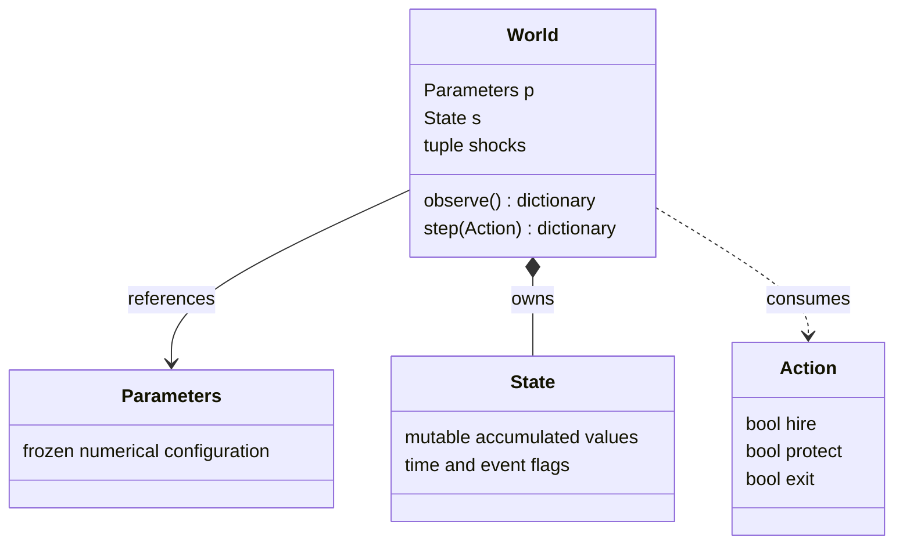

# Understanding the VGC codebase

This guide describes the code as implemented, including its shortcuts. Equations are research hypotheses, not calibrated aircraft-program relationships. Start with the reading path, then use the stock reference or architecture sections as needed.

## Navigation and reading path

1. [The model in one minute](#the-model-in-one-minute)
2. [Code flow tree](#code-flow-tree)
3. [Objects and ownership](#objects-and-ownership)
4. [One simulation step](#one-simulation-step)
5. [Notation and units](#notation-and-units)
6. [Stock and state register](#stock-and-state-register)
7. [Engineers](#engineers)
8. [Remaining design work](#remaining-design-work)
9. [Certification progress](#certification-progress)
10. [Production capacity](#production-capacity)
11. [Backlog and deliveries](#backlog-and-deliveries)
12. [Cash, NPV and exposure](#cash-npv-and-exposure)
13. [Shocks and scenario sampling](#shocks-and-scenario-sampling)
14. [Adaptive decision logic](#adaptive-decision-logic)
15. [Robustness and decision audits](#robustness-and-decision-audits)
16. [Browser functions and data contracts](#browser-functions-and-data-contracts)
17. [Worked first step](#worked-first-step)
18. [Assumptions and limitations](#assumptions-and-limitations)
19. [Where to change things](#where-to-change-things)
20. [Validation and tests](#validation-and-tests)

For causal relationships between the stocks, see [Feedback and cross-stock interactions](#feedback-and-cross-stock-interactions).

Also see the [complete parameter reference](PARAMETERS.md), [setup README](../README.md) and [brief model notes](MODEL.md). Open `index.html` for the offline version with search, a fixed navigation menu and an embedded source browser.

## The model in one minute

The Python model answers “what happens if these conditions and actions occur?” The policy layer answers “which action should be active now?” The browser sends inputs, then displays returned trajectories; drawing a graph does not integrate the model again.

The main chain is:

```text
Available engineers
  -> design completion and rework
    -> design finished
      -> certification progress
        -> certification finished / entry into service
          -> orders + production ramp
            -> backlog-limited deliveries
              -> revenue, production costs and learning
                -> cash, discounted value and peak funding exposure
                  -> adaptive staffing/protection/exit decisions
```

Staffing has an ongoing cost even after design finishes. A staffing shortage also increases rework, extending the program and its costs. This feedback is why the model uses accumulating stocks rather than a single static financial calculation.

## Code flow tree

This is a call/ownership tree, not a directory listing. It shows what calls what.

```text
Interactive application
run.py
  -> changes working directory to repository root
  -> runs vgc_sd.server as __main__
     -> ThreadingHTTPServer on 127.0.0.1
        -> Handler.do_GET('/') -> sends app.html
        -> Handler.do_GET('/health') -> API capabilities
        -> Handler.do_POST('/run')
           -> experiment(request)
              -> Parameters(**request.parameters) -> validate baseline
              -> seeded Latin hypercube columns
              -> for each future: sampled Parameters + realized shock list
                 -> for each policy: NEW World(future, events)
                    -> World owns a NEW mutable State
                    -> while time < horizon
                       -> observe() -> dictionary snapshot of State
                       -> policy review / pending implementation -> Action
                       -> optional continuation(world, action), twice
                          -> deepcopy World -> integrate each private branch
                       -> step(Action) -> update original State + return row
                    -> collect rows, decisions, audit branches and summary
           -> JSON response -> browser result object -> charts/dashboard
        -> Handler.do_POST('/robustness')
           -> robustness(request)
              -> for each exposure limit: deepcopy original request
                 -> experiment(..., include_counterfactuals=False)
                 -> keep adaptive summaries for the matrix

Separate CSV / offline-report application
python -m vgc_sd
  -> __main__.main()
     -> read config/baseline.json, optionally override --years
     -> 3 staffing values x 3 fixed actions
        -> simulate(Parameters, policy_callback)
           -> NEW World (without explicit event shocks)
           -> observe -> callback returns Action -> step -> collect rows
     -> CSVs + manifest.json
     -> report.write_report(...) -> standalone report.html
```

The two entry points are deliberately distinct: the CSV runner does not call the DOE/adaptive `experiment()` function. It retains the legacy single staffing shock defined by its parameters.

## Objects and ownership

| Object | Where it lives | Responsibility | Can it change? |
| --- | --- | --- | --- |
| `Parameters` | [model.py](../vgc_sd/model.py#L6) | Numerical assumptions for one world | Frozen dataclass; create a replacement to change it |
| `Action` | [model.py](../vgc_sd/model.py#L50) | Three booleans: hire, protect, exit | Frozen dataclass; a new action replaces the old one |
| `State` | [model.py](../vgc_sd/model.py#L57) | Current accumulated values and event flags | Mutable, updated by `World.step()` |
| `World` | [model.py](../vgc_sd/model.py#L72) | Owns parameters, shocks and exactly one current state | Evolves its state over time |
| observation | `World.observe()` | Copy of current State as a dictionary | Caller can edit its copy without editing World |
| experiment request | Python/JSON dictionary | Baseline inputs, ranges, shocks and policy settings | Configuration input, not a world state |
| experiment result | Python/JSON dictionary | Independent runs, rows, decisions, summaries and branches | Returned snapshots for plotting/export |
| `Handler` | [server.py](../vgc_sd/server.py#L10) | Converts HTTP requests to function calls | One request handler per connection |
| browser `result` | `app.html` | Holds the last completed experiment in memory | Replaced after a new experiment |

There is no `DAPP` Python class, database or generic solver object. Adaptive policy memory is held in local variables inside `experiment()`: `action`, `pending`, `next_review` and `logs`. Shock events are ordinary dictionaries. `World.shocks` is a tuple of those dictionaries, not a typed shock class; experiment code treats them as read-only. Each policy gets an independent World, so stocks do not leak between runs.



## One simulation step

Source: [World.step](../vgc_sd/model.py#L84). A step uses rates from the start of the interval to compute stocks at its end.

```text
1. Set h = min(dt, horizon - current_time).
2. If the action exits, set exited=True.
3. If exited: advance only time, return frozen stocks and zero main flows.
4. Determine shocks active at the START of the interval.
5. Calculate losses, hires and staffing pressure.
6. Calculate design completion and rework.
7. Calculate certification progress using OLD design work.
8. Determine market/production activity using OLD certification progress.
9. Calculate capacity, orders, deliveries, learning and financial rates.
10. Apply all stock updates using h.
11. Update time, peak exposure and first entry-into-service timestamp.
12. Return end-of-interval State plus rates used during that interval.
```

Important gate timing: if design finishes in this step, certification starts on a later step. If certification finishes in this step, orders and ramp activity start on a later step. Deliveries use old capacity and backlog; same-step orders cannot immediately be delivered. These are implementation choices, not separate physical delays calibrated from evidence.

A returned row at year `t+h` contains **end stocks** and the **interval rates** that produced them. The initial observation has stocks only. After exit, `revenue`, `spending`, `certification_rate` and `capacity_change` are absent from returned rows; consumers use zero defaults for these missing rates. The other main flow keys are explicitly zero. This schema asymmetry matters when writing new data consumers.

## Notation and units

| Symbol | Code field / meaning | Unit |
| --- | --- | --- |
| `t`, `h` | beginning time, actual step length | years from launch, years |
| `E`, `R` | `engineers`, `required_engineers` | full-time-equivalent engineers (FTE) |
| `W` | `work` remaining | FTE-years |
| `Z` | `certification` | fraction, 0 to 1 |
| `K` | `capacity` | aircraft/year |
| `B`, `D` | `backlog`, cumulative `delivered` | aircraft |
| `C`, `V`, `X` | `cash`, `npv`, `peak_exposure` | constant USD million |
| `m`, `u`, `s` | demand, productivity, supply factors | dimensionless |
| suffix `next` | end-of-step value | same as the stock |

Flows have units per year. Updates generally use `stock_next = stock + h * net_rate`. `cert_delta` is already an interval increment and is not multiplied by `h` again. Production capacity is itself a stock measured in aircraft/year, so its adjustment rate is aircraft/year squared.

## Stock and state register

| Field | Type of quantity | Initial condition | Main driver |
| --- | --- | --- | --- |
| `engineers` | resource stock | required engineers × availability | hiring minus losses |
| `work` | remaining workload stock | `design_work` | rework minus completion |
| `certification` | progress accumulator | 0 | readiness-gated progress |
| `capacity` | capability stock | 0 | adjustment toward target |
| `backlog` | order stock | 0 | orders minus deliveries |
| `delivered` | cumulative output | 0 | deliveries |
| `cash` | net cash accumulator | negative `capex` | revenue minus spending |
| `npv` | discounted cash accumulator | negative `capex` | discounted net cashflow |
| `peak_exposure` | running historical maximum | `capex` | maximum funding requirement reached |
| `time` | simulation clock | 0 | advances by h |
| `eis` | first-event timestamp | `None` | first end-step certification at 1 |
| `exited` | absorbing status flag | `False` | exit Action |

`npv` and `peak_exposure` are accounting measures, not conserved physical stocks. `eis` and `exited` are events/status. Calling every plotted field a “stock” would hide these distinctions.

## Engineers

Source: [World.step](../vgc_sd/model.py#L84). Initial engineers: `E0 = R * availability`. Availability 0.8 means 80% of the program requirement, not 80% of the corporation's workforce.

```text
diversion_rate = diversion + legacy_shock_if_started + active_diversion_magnitudes
if protect: diversion_rate = 0.2 * diversion_rate

losses = min(E/h, E * (attrition + diversion_rate))
hires  = max(0, R-E)/hiring_delay + losses    if hire
         0                                 otherwise

E_next = E + h * (hires - losses)
```

Assumptions: engineers are homogeneous; protection does not reduce attrition; hiring immediately replaces current losses while gradually closing the staffing gap. The `hiring_delay` parameter is an adjustment time, not a recruitment pipeline with no initial hires. Hiring cannot deliberately expand staffing above R. Loss capping prevents negative engineers.

Consequence worth noticing: with hire enabled, net staffing change simplifies to `max(0,R-E)/hiring_delay`. Diversion increases gross hires, but does not reduce net staffing in this formulation. If availability exceeds 1, enabled hiring replaces losses and keeps staffing above R rather than bringing it down. These behaviors should be revisited if realistic recruitment constraints are central.

## Remaining design work

```text
pressure  = max(0, 1 - E/R)
completed = min(W/h, E * u)                  if W > 1e-9
            0                              otherwise
rework    = completed * rework_fraction * min(1, pressure)
W_next    = max(0, W + h * (rework - completed))
if W_next < 1e-9: W_next = 0
```

Initial workload is `design_work`, in FTE-years. At productivity factor 1, one engineer supplies one FTE-year per year. Rework is a fraction of completed work, not a separate inspection/discovery stock. It returns to the same workload immediately. Pressure increases only when staffing is below requirement. Productivity shocks reduce gross completion, and therefore also reduce the volume of rework generated in that interval. There is no skill mix, burnout, task dependency or explicit technology subsystem model.

## Certification progress

```text
cert_rate  = u * min(1, E/R) / certification_years
             only if OLD W == 0 and OLD Z < 1; otherwise 0
cert_delta = min(1-Z, cert_rate * h)
Z_next     = Z + cert_delta

if Z_next >= 1 and eis is None: eis = t+h
```

Certification is a progress proxy that uses the full staffing ratio, not a separately allocated team. It cannot exceed one; additional engineers above requirement do not accelerate it. Productivity shocks also slow certification. No explicit regulator queue, approval uncertainty, rejected tests or certification regression exists. Nominal certification time assumes sufficient staffing and no productivity shock. Total certification spending is tied to progress, so a pure delay does not increase that budget; it increases ongoing engineering/overhead costs instead.

## Production capacity

```text
active = (OLD Z >= 1)
capacity_rate = (capacity_target-K)/ramp_years    if active
                0                              otherwise
K_next = K + h * capacity_rate
```

Capacity starts at zero and rises by first-order adjustment after certification. It does not wait for deliveries, demand or a cash-availability check. There is no depreciation, plant construction stock, production workforce or supplier investment model. Supply shocks limit current deliveries; they do not destroy capacity. The current validation requires `dt <= ramp_years`, supporting a bounded non-oscillatory adjustment from the initial zero capacity.

## Backlog and deliveries

```text
orders = m * market_units * (1+market_growth)^t * capture_share    if active
         0                                                      otherwise
deliveries = min(K*s, B/h)                                       if active
             0                                                  otherwise

B_next = B + h * (orders-deliveries)
D_next = D + h * deliveries
```

Initial backlog and deliveries are both zero. Market units are an annual demand rate, not fleet size. Growth compounds annually with a continuous year exponent. Capture share is fixed and not a market-share stock. Market growth is nonnegative under current parameter validation; temporary demand reductions use shocks instead. There are no pre-certification orders/deposits, cancellations, replacement-fleet dynamics, rival choices or delivery inventory. Fractional aircraft are expected because this is a continuous model.

Deliveries only use the backlog and capacity available at the interval start. That convention, plus zero initial backlog/capacity, adds small numerical gate delays even after certification.

## Cash, NPV and exposure

```text
learned_unit_cost = unit_cost * max(1, D/10)^(-learning_exponent)
learned_unit_cost = max(0.6*unit_cost, learned_unit_cost)

revenue = price * deliveries
spending = learned_unit_cost * deliveries
           + engineer_cost * E + overhead
           + certification_cost * cert_delta/h
           + (protection_cost if protect else 0)
net_flow = revenue - spending

C_next = C + h * net_flow
V_next = V + h * net_flow / (1+discount_rate)^(t+h)
X_next = max(X, -C_next)
```

Initial `C = V = -capex`, `X = capex`. The code calculates `flow` with an algebraically equivalent expanded expression. Revenue is recognized at delivery. Costs and money are real, constant USD million. Engineer cost is per FTE/year; price and unit cost are per aircraft. The learning reference of 10 aircraft and cost floor of 60% are hard-coded assumptions, not editable parameters. No learning benefit applies below 10 cumulative deliveries.

Peak exposure never decreases even when cash recovers. It measures historical funding need, not current burn or a corporate bank balance. Discounted NPV starts negative and includes no terminal value. No tax, interest, borrowing constraint, working capital, inflation, currency conversion, service income or salvage exists. Unit cost implicitly includes production labor, while program engineers are charged separately; calibration must avoid overlapping cost definitions.

If `exit=True`, only time advances. Work, engineers, certification, cash, NPV, exposure and deliveries freeze. No severance, wind-down costs or recoveries occur. This can mechanically make exit look financially attractive.

## Shocks and scenario sampling

Source: [experiment](../vgc_sd/experiment.py#L30). A future is a sampled parameter set plus a realized list of shock events. A policy is an action rule. These are separate dimensions: all four policies face the same future.

For N futures and a range [low, high], each Latin hypercube column draws:

```text
value_j = low + (high-low) * (j + Uniform(0,1)) / N
j = 0 ... N-1
shuffle the column independently before combining columns
```

Supported parameter ranges are `availability`, `market_growth`, `hiring_delay`, `certification_years`. Each shock independently samples start, duration and magnitude with the same procedure. Equal endpoints fix a value. No distributional likelihood or correlations are inferred. Reproducibility requires the seed, source revision, request structure and ordering; reordering ranges/events changes how the random stream is consumed.

An event is active if `start <= t < start+duration`, evaluated at the step start. Durations can extend beyond the horizon. A legacy optional jitter shifts the sampled start and clamps it to [0,horizon]; the current UI sends zero jitter.

| Type | Combination while active | Main formula affected |
| --- | --- | --- |
| diversion | add event magnitudes to annual diversion rate | losses; moderated by protection |
| demand | m = product of (1-magnitude) | order inflow |
| productivity | u = product of (1-magnitude) | design completion and certification |
| supply | s = product of (1-magnitude) | delivery throughput |

Two 20% demand shocks give `m=0.8*0.8=0.64`, a 36% reduction, not 40%. Events are deterministic once sampled and have rectangular time profiles. Every listed event happens once in every future; no probability of occurrence or sampled event count exists. Capacity/financial consequences may persist after a shock ends. Browser `shockEffects` filters visual overlays; it does not control the equations or eliminate indirect effects.

## Adaptive decision logic

Policy state is inside [experiment](../vgc_sd/experiment.py#L30). The full world does not know which policy name is running; it only receives Action booleans.

```text
At the START of each integration interval:
  A. If a pending action is due:
       optionally create two audit branches from the pre-action world
       replace current Action; log implementation; clear pending
  B. If a review is due and world has not exited:
       schedule next_review = now + review_interval
       ratio = engineers / required_engineers
       desired.hire = current.hire OR ratio < hire_at
       desired.protect = current.protect OR ratio < protect_at
       desired.exit = peak_exposure >= cash_limit
       if desired differs and no pending action:
          queue desired for now + latency
          log trigger values, reasons and decision ID
  C. World.step(current Action)
```

The first review is at time zero. Hire/protect use strict `<`; exit uses `>=`. Protection can trigger simultaneously with hiring. Escalation is irreversible for hire/protect. Actions are packages of three booleans, not independent queued interventions. Pending actions cannot be cancelled or upgraded; an exposure breach can wait behind a pending staffing action. Reviews use observed stocks, not future shocks.

An exit threshold is a policy signpost, not a hard funding cap: exposure can keep increasing between crossing, review and implementation. Reviews and action times are snapped to integration steps. Even zero configured latency implements no earlier than the next loop because implementation is checked before the current review. The observed state is copied before implementation and `step()` marks exit later in the loop; event/state timestamps therefore require careful reading near exit.

```text
Baseline -- staffing below hire threshold --> Hire
   |                                         |
   +-- below protect threshold --------------+--> Protect + hire
   |                                         |          |
   +--------------- exposure >= limit -------+----------+--> Exit

Every transition includes review timing and implementation delay.
```

These are candidate DAPP rules; there is no pathway optimizer, RL agent or formal tipping-point solver. Fixed policies are baseline (all flags false), hire (hire true) and protect_hire (hire/protect true). Browser colors label implemented actions, not a mathematical bifurcation.

## Robustness and decision audits

Source: [robustness](../vgc_sd/experiment.py#L134) and [continuation](../vgc_sd/experiment.py#L16).

Robustness reuses the request and seed for each exposure limit, disables counterfactual calculations, calls the full experiment again and returns adaptive summaries. The same future ID has the same inputs/shocks at each limit. All four policies are currently simulated internally even though only adaptive summaries are returned. The browser applies:

```text
success = not exited
          AND eis is not None AND eis <= selected_latest_EIS
          AND npv >= selected_minimum_NPV
coverage = count(successful sampled futures) / count(sampled futures)
```

Coverage is a design-space fraction, not an estimated probability. Changing criteria reclassifies completed summaries; changing the actual cash trigger requires simulation. NPV/EIS criteria and sweep results live in browser state separately from the experiment result. They are not included in the current main experiment JSON export; record them with research notes.

For a decision audit, `continuation()` deep-copies the entire pre-implementation World. Two branches start with identical stocks and shocks. One holds the prior Action and the other holds the new Action for the remainder of the horizon. Future adaptive changes are disabled in both. This tests a decision package conditional on this particular state/future; it is neither empirical causality nor a replay of the eventual adaptive path.

Branch revenue/spending are integrated from that branch point. Extra revenue minus extra spending equals the branch difference in final undiscounted cash. NPV still includes shared pre-decision history, which cancels in a difference. Peak exposure also includes shared historical exposure; its difference is the additional project funding burden, not a fresh post-decision maximum.

## Browser functions and data contracts

Source: [app.html](../vgc_sd/app.html). It is plain JavaScript without a framework or external plotting library.

| Function/group | What it does | Does it run Python? |
| --- | --- | --- |
| `request()` | Reads current fields into a JSON-ready request | No |
| run-button handler | POSTs request to `/run`, replaces `result`, sets up views | Yes |
| `readApiResponse()` | Parses JSON or explains stale-server/HTTP errors | No |
| `render()`, `at()` | Selects future and most recent row at/before slider time | No |
| `drawAdaptiveChart()`, `segments()` | Plots one adaptive trajectory, colors action segments | No |
| `drawPathways()`, `drawDecisions()` | Builds DAPP bands, trigger details and decision table | No |
| `diagram()` | Draws current stock/flow network | No |
| `relevantShocks()`, `shockBands()`, `shockTracks()` | Filters and renders descriptive overlays | No |
| `setupDashboard()`, `drawDashboard()`, `ensembleChart()` | Builds future fingerprints and staffing/finance views | No |
| `criteria()`, `succeeds()` | Applies dashboard success criteria | No |
| `explainFuture()` | Finds first recorded crossing, review and implementation | No |
| sweep-button handler | POSTs experiment request and limits to `/robustness` | Yes |
| `drawSweep()` | Colors returned future/limit cells against current criteria | No |
| `drawDecisionEffect()` | Renders precomputed same-state audit branches | No |
| `download()` and file-load handler | Saves/loads JSON in browser | No |

```text
Request
  parameters: {horizon, dt, required_engineers, ...}
  ranges: {availability: [min,max], ...}
  samples, seed
  shocks: [{kind, start_range, duration_range, magnitude_range}, ...]
  adaptive: {hire_at, protect_at, cash_limit, review, latency}

Result
  request, seed, note
  runs[]
    run, future, policy
    parameters, shocks
    rows[]                 end-step states + interval flow rates
    decisions[]            triggered / implemented, ID, action, reasons
    counterfactuals[]       paired keep/change continuations
    summary                eis, npv, peak_exposure, delivered, exited
```

The server stores no experiment database. Browser refresh discards in-memory results. The slider chooses existing rows; hover only shows tooltips. The browser health endpoint does not report the entire source revision; it only advertises API capabilities. Restart Python after backend changes.

## Worked first step

Use `Parameters()` defaults with baseline Action at t=0. No event shock is active and the legacy permanent shock starts in year 3. Here h=1/52, R=1000, E=800 and W=6000.

```text
losses = 800 * (0.04+0.08) = 96 FTE/year
hires = 0
E_next = 800 - 96/52 = 798.153846 FTE

pressure = 1-800/1000 = 0.2
completed = 800 FTE-years/year
rework = 800 * 0.12 * 0.2 = 19.2 FTE-years/year
W_next = 6000 + (19.2-800)/52 = 5984.984615 FTE-years

certification = capacity = orders = deliveries = 0
revenue = 0
spending = 800*0.18 + 40 = 184 USD million/year
cash_next = -500 - 184/52 = -503.538462 USD million
peak_exposure_next = 503.538462 USD million
npv_next = -500 - (184/52)/(1.08)^(1/52)
```

Under `Action(hire=True)`, hires become `200/1.5 + 96 = 229.333333 FTE/year`, so E_next becomes 802.564103. **Design progress and engineering costs in this first interval still use the original 800 engineers**, because rates use the beginning state. New hires affect those calculations on subsequent intervals.

## Assumptions and limitations

| Topic | Current assumption | Why it matters / evidence needed |
| --- | --- | --- |
| workforce | homogeneous, instant replacement of losses when hiring | Can understate diversion/hiring constraints; need skill/pipeline data |
| allocation | same engineer stock drives both design and certification | No explicit specialist allocation or production staffing |
| rework | immediate staffing-pressure function | No measured defect discovery/recovery process |
| readiness | design work then scalar certification progress | Not technology TRL, regulator approval or systems integration evidence |
| investment | capex at t=0; capacity ramps automatically | No staged capex, industrial build stock or liquidity checks |
| market | fixed capture share and nonnegative trend growth | No endogenous customer choice, competitors or declining trend scenario |
| production | backlog/capacity-limited, continuous aircraft | No materials stock, integer schedules or cancellations |
| learning | reference 10 aircraft, 60% cost floor | Hard-coded; requires evidence and potential parameterization |
| finance | constant USD, revenue at delivery | No deposits, tax, debt, inflation, FX, service income or terminal value |
| exit | freezes operations/cash with no closure cost | Can overvalue exit and distort robustness comparisons |
| uncertainty | independent ranges/events, every event occurs | Coverage is not probability; correlations may be important |
| decisions | threshold rules, irreversible escalation, queued delay | Not optimized DAPP; pending actions may block timely exit |
| numerics | explicit Euler and step-based gates | Outcomes can change with step size near certification/exit |
| visuals | channel-based overlays and event markers | Not causal attribution or detection of mathematical tipping points |

Default sources differ: `Parameters.horizon` is **25 years**, interactive HTML defaults and the supplied CSV config use **20 years**. UI fields are built from JavaScript `defaults`, not loaded from `config/baseline.json`. The UI disables `shock_diversion`; the CSV config does not. Always retain the complete request when comparing results. No project input has been calibrated merely because a number resembles a presentation figure.

## Feedback and cross-stock interactions

| Source quantity | Direct influence | Downstream consequence |
| --- | --- | --- |
| engineers | completion, rework pressure, certification rate and engineering spend | schedule and exposure |
| remaining work | gates certification start | delays production/orders and revenue |
| certification | gates capacity adjustment and orders | enables delivery accumulation |
| capacity and backlog | jointly limit deliveries | shape revenue and outstanding demand |
| cumulative deliveries | lowers learned unit cost | improves operating cashflow |
| cash | sets historical peak exposure | can trigger exit at a later review |
| staffing ratio | triggers hiring/protection | changes the action supplied to future steps |
| exit | freezes operational stocks and cash | truncates remaining program activity |

The equations and policy interact through information signals as well as physical/accounting flows. Money does not literally flow into engineer headcount; the policy changes a rate rule. Certification fraction does not literally transfer into production capacity; it gates a capability adjustment.

```text
Staff shortage -> lower design completion + greater rework fraction
              -> more work remaining -> later certification
              -> revenue starts later -> cash exposure can grow
              -> policy may exit -> operational stocks freeze

Staff shortage -> hiring signpost -> queued hiring Action
              -> staffing gap closes -> shortage shrinks

Delivered aircraft -> experience -> lower unit cost
                   -> better contribution per aircraft -> improved net cash
```

Not every arrow forms a closed endogenous loop. Market demand does not respond to deliveries, price or reputation in the current implementation. Cash availability does not constrain hiring, capex or ramp directly; it only informs the optional exit rule. Protection while hire is already active reduces gross losses and replacement hiring, but the simplified net staffing recovery is unchanged because hiring replaces all losses. Recognizing these open or simplified links helps identify where additional SD structure would be useful.

## Where to change things

| Goal | Start here | Also check |
| --- | --- | --- |
| change stock physics/economics | `World.step()` | balance/gating tests, units, docs |
| add a stock | `State`, `World.__init__`, `World.step` | exit branch, observations, results, plots and tests |
| add an editable parameter | `Parameters` | HTML defaults/units, validation, examples, parameter reference |
| sample another parameter | `experiment()` supported-range allowlist | HTML ranges UI, input loading and tests |
| add a shock type | shock validation and World shock loop | HTML kind selector, descriptions, overlay channel map |
| change adaptive rules | policy loop inside `experiment()` | reason strings, action memory, tests and UI naming |
| change event latency | adaptive settings / loop ordering | grid timing and pending-action behavior |
| change dashboard success | `criteria()` / `succeeds()` | no backend rerun needed for criteria alone |
| change the sensitivity analysis | `robustness()` and sweep handler | paired-future reproducibility and response contract |
| change charts/tooltips/layout | `app.html` | browser runtime checks, no equation changes needed |
| change offline CSV comparisons | `__main__.py`, `report.py`, `report.html` | separate from interactive DOE/policy path |

## Validation and tests

| File | What it checks |
| --- | --- |
| `tests/test_model.py` | stock balances, no deliveries before certification, nonnegative stocks, zero staffing, absorbing exit, determinism, selected dt/2 comparison |
| `tests/test_experiment.py` | Latin hypercube strata, matched shocks, reproducibility, shock expiry, decision IDs/reasons/delays, paired branches/cash reconciliation and identical-future robustness |
| `tests/test_report.py` | embedded initial/final report data and offline script behavior |
| `tests/test_server.py` | local health, HTML, simulation/sensitivity endpoints and JSON errors |

These checks support implementation consistency, not empirical validity. There is no exhaustive convergence proof, calibration suite, correlation validation or packaged real-browser test suite. When changing an equation, validate units, limiting cases and numerical sensitivity before interpreting output trends.
